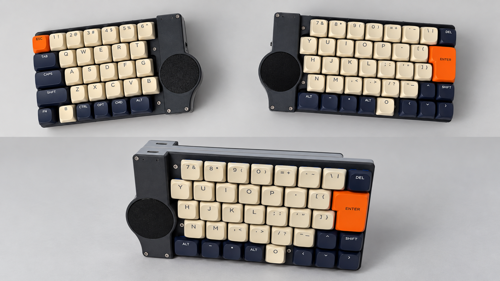
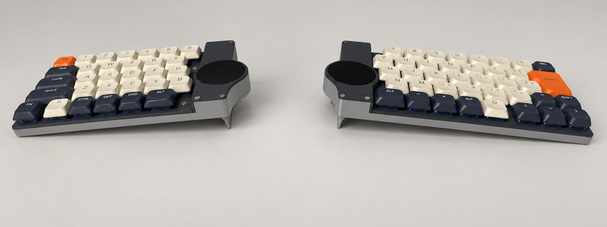

# ハードウェア

[カスタマイズ記録](README.md) / [パッドの動作・調整](trackpad.md)

## 取り付けたもの

左右それぞれのXIAO nRF52840 Plusに、Cirque **TM040040-2024-302**を1枚ずつ接続した。型番はTM040040。ファイル名などで使っていたMT040040表記とは区別する。

- 購入先例：[MOUSER：TM040040-2024-302](https://www.mouser.jp/ja/ProductDetail/Cirque/TM040040-2024-302?qs=wd5RIQLrsJgMzmw571gvDw%3D%3D)
- [Cirque仕様書](https://www.mouser.com/pdfdocs/TM040040_SPI-I2C-PINNTrackpad_SPEC1-21.pdf)
- [XIAO nRF52840 Plusの表面端子](https://wiki.seeedstudio.com/XIAO_BLE/#xiao-nrf52840-plus-front)

パッド裏面のランドに直接はんだ付けし、XIAO側も見えている表面のランドを使用。基板に密着しているXIAOを取り外す必要はなかった。

<!-- 写真：左右の取り付け状態、パッド裏面とXIAO表面の配線 -->

## 配線と色

端子の割り当ては左右共通。ケーブル色だけ一部異なる。

| パッド端子 | XIAO | GPIO | 右の色 | 左の色 |
|---|---|---|---|---|
| GND | GND | — | 黒 | 黒 |
| VDD | 3V3 | — | 赤 | 白 |
| SS / CS | D11 | P0.15 | 茶 | 灰 |
| DR | D12 | P0.19 | 橙 | 紫 |
| SCK | D17 | P1.03 | 黄 | 黄 |
| SO / MISO | D18 | P1.05 | 緑 | 緑 |
| SI / MOSI | D19 | P1.07 | 青 | 青 |

電源はXIAOの3V3とGND。VDDにBAT+や5VのVBUSは使わない。SPI接続なのでR1は取り付けたまま。B1/B2/B3、SCL/SDA、FFCコネクタは使用していない。

XIAOをUSB端子が上、シールド面が手前になる向きで見ると、追加GPIOの表面ランドは次の位置。

| 位置 | 端子 |
|---|---|
| 左側のD0とD1の間 | D11 |
| 左側のD1とD2の間 | D12 |
| 右側のD10とD9の間 | D19 |
| 右側のD9とD8の間 | D18 |
| 右側のD8とD7の間 | D17 |

右側の大きな端子は上から2番目がGND、3番目が3V3。下端の2列×3個の長方形パッドは今回のGPIOではない。

## 薄型トラックパッドケース

コンセプトは薄型と左右トラックパッドの追加。STLは[models/slim_trackpad_case](../../models/slim_trackpad_case/)に置く。ファイル名の共通接頭辞は `slim_trackpad_case-`。

| 部品 | 左 | 右 |
|---|---|---|
| ベース | `left_case_base.stl` | `right_case_base.stl` |
| 上カバー | `left_case_top_cover.stl` | `right_case_top_cover.stl` |
| トッププレート | `left_case_top_plate.stl` | `right_case_top_plate.stl` |
| パッドマウント | `left_trackpad_mount.stl` | `right_trackpad_mount.stl` |

共通部品は `power_switch_knob.stl`。表中の各名前にも共通接頭辞を付ける。

完成したキーボードの全体と、テンティングスタンドを取り付けた状態。

テンティングスタンドを立てると、左右それぞれに角度を付けて設置できる。

<!-- 写真：マウント、ケース内の配線の取り回し -->

配線に対応するファームウェア側の定義・入力経路は[組み込み実装メモ](../../docs/cirque-trackpad-integration.md)に残す。
